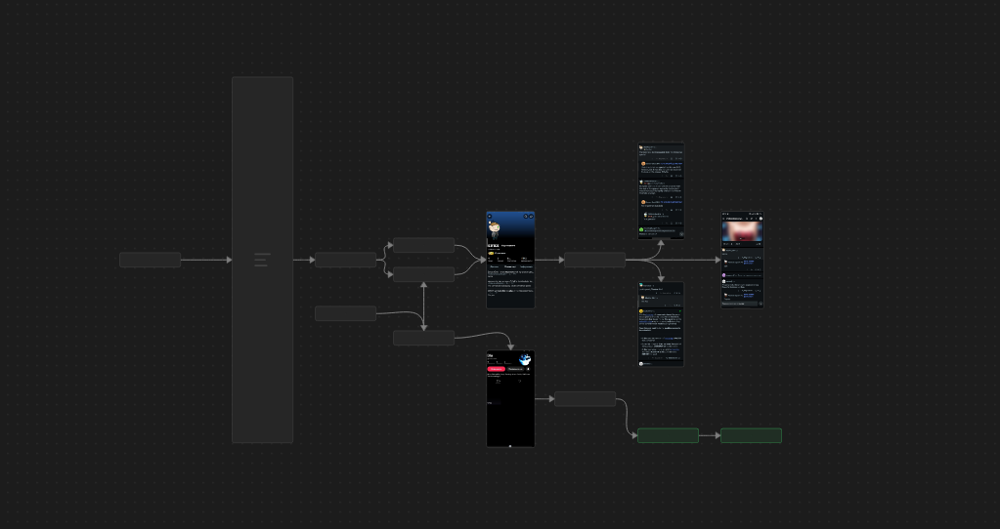

# 🕵️ OSINT Case Study: Target Investigation (`@bluefox_404`)

| Parameter | Details |
| :--- | :--- |
| **Case ID** | OSINT-2026-001 |
| **Category** | SOCMINT / Username Footprinting / GEOINT |
| **Target Identity** | `@bluefox_404` |
| **Status** | Completed |

---

## 📌 Executive Summary
This investigation focused on performing passive reconnaissance and open-source intelligence gathering on the handle `bluefox_404`. The objective was to map the target's digital footprint across platforms, establish primary communication channels, extract behavioral patterns/interests, and pinpoint a specific physical location visited in 2024.

---

## 🎯 Objectives
1. **Platform Discovery:** Enumerate platforms where the username `bluefox_404` is registered.
2. **Primary Profile Identification:** Determine the primary and most active social media profile.
3. **Interest Profiling:** Identify main hobbies, interests, and subculture affiliations.
4. **GEOINT Verification:** Pinpoint the exact address of the club visited by the user in 2024.

---

## 🛠 Methodology & Tools
* **Username Enumeration:** OSINT footprinting tools (Sherlock / Maigret) and manual registry checks.
* **SOCMINT & Content Analysis:** Deep dive into activity on Reddit and TikTok.
* **GEOINT & Search Verification:** Image/video analysis, contextual metadata correlation, and location verification.

---

## 🔍 Investigation Workflow

### Phase 1: Initial Footprinting & Pivot Identification
* Executed username enumeration for `bluefox_404`.
* Identified active presence on **Reddit** and **TikTok**.

### Phase 2: Reddit Profiling (Contextual Lead)
* Analyzed historical activity, posts, and comments on Reddit.
* Uncovered key interests in **cosplay subculture**.
* Discovered a specific contextual lead / alias: **"Phantom Cat"** (*Фантомний Кіт*).
* *Note:* Initial web searches for this alias produced broad results, prompting a pivot to media-rich platforms.

### Phase 3: TikTok Analysis & Geolocation (Primary Evidence)
* Pivot to TikTok revealed it as the target's primary social media profile based on engagement and frequent original uploads.
* Validated cosplay interest and subculture involvement.
* Through visual content analysis (interior landmarks / geotags / event dates from 2024 uploads), successfully pinpointed the exact club venue visited.

---

## 📊 Investigation Findings

| Objective | Result / Identified Data |
| :--- | :--- |
| **Registered Platforms** | Reddit, TikTok *(and other detected platforms)* |
| **Primary Active Profile** | **TikTok** (`@bluefox_404`) |
| **Core Interests** | Cosplay, "Phantom Cat" subculture |
| **2024 Club Location** | `[ Встав назву та адресу клубу тут ]` |

---

## 💡 Key Takeaways
1. **Cross-Platform Pivoting:** Text-based contextual leads on discussion forums (Reddit) often provide the necessary context to filter visual intelligence on video platforms (TikTok).
2. **SOCMINT to GEOINT:** Short-form video platforms contain rich unstructured geolocation data (backgrounds, ambient lighting, signage) useful for physical location correlation.

