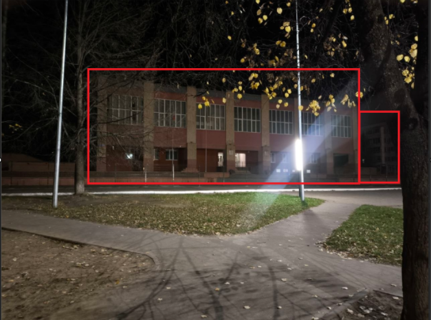

# 🗺️ GEOINT Case #02: Educational Facility Location Identification

> **Category:** Geospatial Intelligence (GEOINT) / Image Geolocation  
> **Target:** Identify exact facility address and coordinates from a single building photograph  
> **Investigation Status:** Completed (100% Accuracy)

---

## 📌 Target Image & Findings

### 📍 Location Summary
| Parameter | Identified Details |
| :--- | :--- |
| **Facility Name** | Средняя общеобразовательная школа № 1 (Secondary School No. 1) |
| **Full Address** | Prospect Mira 39, Elabuga, Republic of Tatarstan, 423603 |
| **Country / Region** | Republic of Tatarstan |
| **Coordinates** | `55.76212, 52.04368` *(approximate target coordinates)* |
| **Primary Method** | Visual Search, Architectural Pattern Matching, Environmental Context Triangulation |

---

## 🔍 Investigation Workflow & Methodology

### Phase 1: Feature Isolation & Visual Extraction
* **Primary Target Isolation:** Isolated the main architectural structure (school building façade, window layout, and entrance structure).
* **Secondary Contextual Identifiers:**
  * Identified an adjacent building on the right side of the frame.
  * Extracted specific perimeter features, including fence design, surrounding vegetation, and sidewalk alignment.

### Phase 2: Reverse Visual Search & Pattern Matching
* Executed a targeted reverse image search on cropped features using **Yandex Visual Search** (optimized for regional architectural databases).
* Analyzed visual matches to filter out standard Soviet-era school designs (type/standard projects) by cross-referencing unique structural modifications, wall coloring, and entrance details.
* Located exact visual duplicates matching the specific building in **Elabuga, Republic of Tatarstan**.

### Phase 3: Spatial Triangulation & Address Verification
* Cross-referenced the isolated adjacent building and fence structure against satellite imagery and panoramic maps.
* Confirmed the spatial alignment of the surrounding infrastructure (adjacent structure, perimeter fence, and road layout along Prospect Mira).
* Verified the exact address: **Prospect Mira, 39, Elabuga**.

---

## 🛠️ Tools & Technologies Used
* **Reverse Image Search:** Yandex Images / Visual Search
* **Geospatial Mapping:** Satellite & Panoramic Mapping Tools
* **Image Editing / Cropping:** Feature Isolation & Focus Extraction

---

## 🏁 Conclusion
The geolocation target was successfully resolved by combining automated reverse image intelligence with manual verification of adjacent infrastructure (fences and neighboring structures).
