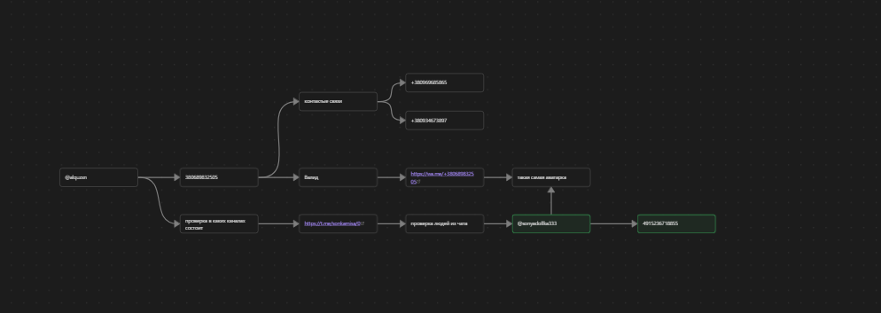

# 🔍 OSINT Case Study: Identifying an Anonymous Telegram Spammer via Cross-Platform Correlation

## 📌 Executive Summary
This case study documents a real-world Open Source Intelligence (OSINT) investigation conducted to identify an anonymous individual engaging in targeted Telegram spam and trolling directed at personal contacts. 

Through standard telephone number pivot techniques, social media channel participant analysis, and cross-platform profile correlation (WhatsApp & Telegram), the subject's primary personal account was identified, leading to direct resolution and mitigation of the threat.

---

## 🎯 Target Overview & Objective
* **Incident Type:** Target harassment / Telegram spamming & trolling via an alternate/throwaway account.
* **Initial Artifacts:** 
  * Phone number associated with the account (retrieved via OSINT Telegram bots).
  * Profile photo snippet (cropped image displaying only eyes).
* **Objective:** Identify the true identity or primary daily-use Telegram account of the individual responsible.

---

## 🛠️ Tools & Methodologies Used
* **Phone Number Intelligence:** OSINT Telegram lookup utilities & WhatsApp Metadata Analysis.
* **Telegram Channel Intelligence:** Fanstat Bot (Telegram channel/chat participation analytics).
* **Cross-Platform Visual Correlation:** Comparative analysis of cropped avatar imagery across platforms.
* **Social Engineering / Verification:** Direct communication for identity confirmation and threat mitigation.

---

## 📐 Investigation Methodology & Workflow

### Phase 1: Initial Phone Number Reconnaissance
1. Extracted the telephone number associated with the spammer account using initial OSINT bot querying.
2. Queried the phone number across major messaging and social platforms:
   * **Result:** No significant public data breaches or direct social media registrations were found, except for an active **WhatsApp** profile.
   * **Key Artifact Found:** A low-visibility avatar image showing only the subject's eyes.

### Phase 2: Community & Activity Footprint Analysis
1. Utilized **Fanstat** (Telegram analytical bot) to query the target's account activity and channel subscriptions.
2. Discovered participation in a niche personal travel blog/channel hosted by a private creator.
3. Conducted a manual audit of the channel's subscriber list and active commenters.

### Phase 3: Visual Identity Correlation & Target Identification
1. Cross-referenced the profile images of the channel subscribers against the WhatsApp avatar discovered in Phase 1.
2. **Positive Match Identified:** Located a personal Telegram profile belonging to a member of the channel whose profile picture matched the exact WhatsApp avatar (eyes/face snippet).

  

3. Confirmed this account to be the primary personal identity of the subject.

### Phase 4: Resolution & Mitigation
1. Contacted the subject directly on their primary Telegram account using the gathered evidence.
2. Confronted the subject regarding the unauthorized activity.
3. **Outcome:** Target acknowledged ownership, admitted responsibility, and agreed to cease all unwanted communications immediately.

---

## 💡 Key Takeaways & Operational Intelligence
* **OPSEC Failures by Target:** Reusing the same avatar across a primary account and a throwaway/spam account drastically reduces anonymity.
* **Cross-Platform Correlation:** Combining analytical tools (Fanstat) with manual visual verification remains one of the most effective methods for tracking pseudonymous identities.
* **Resolution:** Successfully resolved without escalations through structured, evidence-based confrontation.

---
*Disclaimer: All investigation steps were conducted strictly for personal defense, threat mitigation, and educational OSINT portfolio purposes.*
